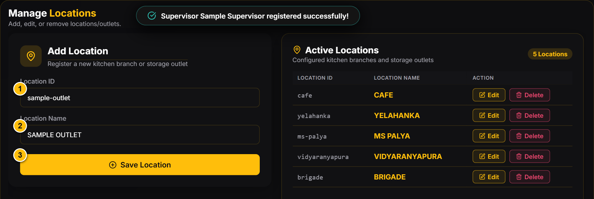
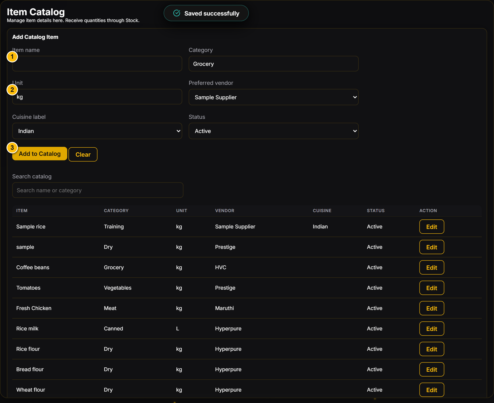
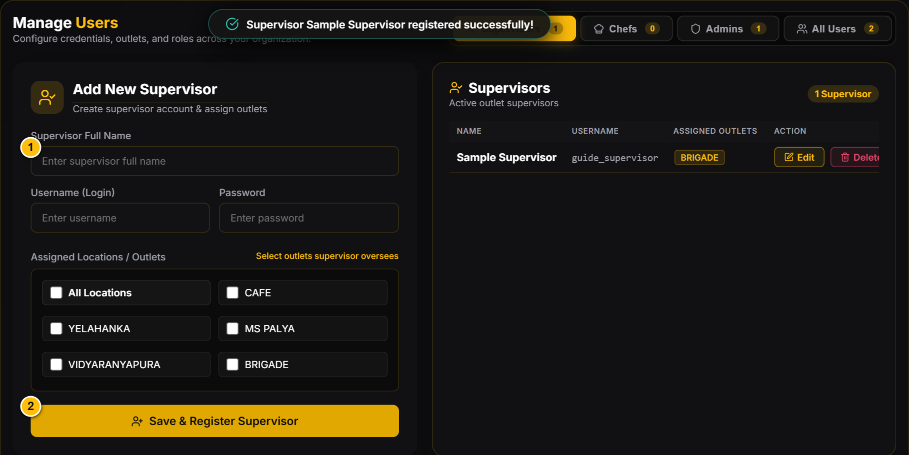
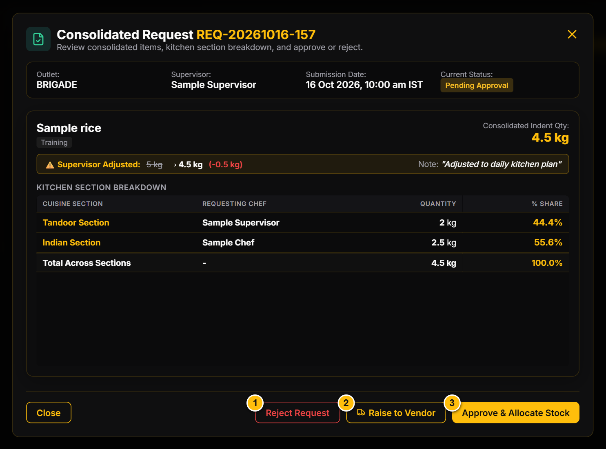
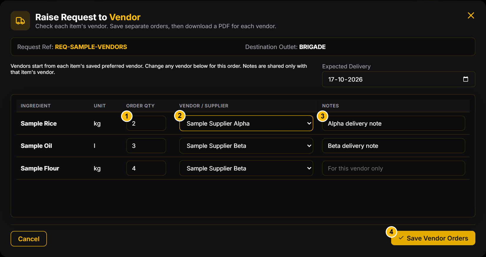
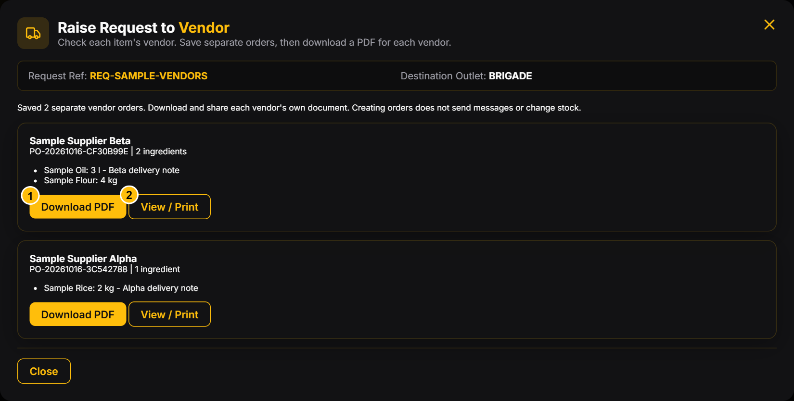
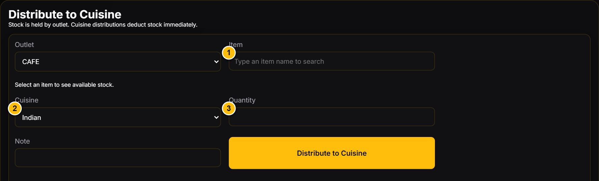
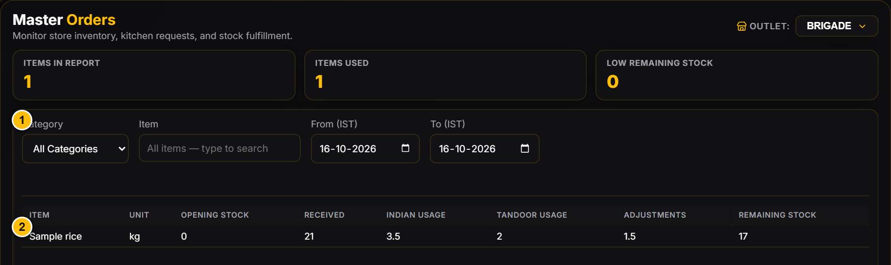

# N-CHEF | Admin guide

Revision: 16 October 2026 | English | Desktop edition

Manage outlet setup, people, requests and stock. Screenshots use a disposable local database and fictional staff and transactions. Existing catalog names are example configuration, not evidence of live stock.

## 1. Your role and daily checklist

Admins manage all outlets, master data and users. Only Admins approve consolidated requests, maintain the item catalog and cuisine sections, or assign and reconcile legacy stock.

- Confirm the outlet before recording or reviewing a transaction.
- Review incoming consolidated requests and cuisine quantities.
- Approve stock issues only when sufficient outlet stock exists. Use Raise to Vendor to prepare separate supplier orders when replenishment is needed.
- Check receipts, distributions and adjustments in Stock History.
- Review Master Orders for the required IST date range.

> Stock rule: approval is a stock issue. Approve & Allocate Stock deducts available stock from the destination outlet and records distribution to cuisines. Do not manually distribute the same approved quantities again. There is no central stock pool.

## 2. Sign in and sign out

1. Open the N-CHEF address provided by your organization.
2. Enter your assigned Username and Password, then click Login.
3. Confirm that your account name and Admin navigation appear.
4. Use the Logout icon beside your account when finished.

Expected result: the app opens your permitted workspace. Sessions expire after eight hours; sign in again if asked. If you cannot sign in, ask another Admin to verify your account or reset its password through Users.

Sample data. Callouts: 1 Username; 2 Password; 3 Login. No password is shown.

## 3. Set up locations, vendors and cuisines

### Locations

1. Open Locations under Administration.
2. Enter a unique Location ID and Location Name.
3. Click Save Location and confirm the new row appears.
4. To rename a location, use its Edit action and save. Keep the existing ID.

### Vendors and cuisine sections

1. Open Vendors, enter the vendor name and click Save Vendor. Use Edit to rename an existing vendor.
2. Open Cuisine Sections, enter a Name and click Add Section.
3. Confirm the new entries are available before assigning chefs or creating catalog items.

Expected result: master data is available to the appropriate forms. Creating a location or vendor does not add inventory. Cuisine Sections supports adding sections; do not expect a cuisine delete or rename control.

Sample data. Callouts: 1 Location ID; 2 Location Name; 3 Save Location.

## 4. Maintain the item catalog

1. Open Item Catalog. Enter Item name, Category and Unit.
2. Choose the Preferred vendor and Cuisine label. Set Status to Active.
3. Click Add to Catalog. Confirm the item appears in the list.
4. Search by name or category and click Edit to change its metadata. Click Save Changes.
5. To stop future receipts and distributions for an item, edit its Status to Inactive.

Expected result: the ingredient becomes selectable in operational forms. Catalog creation adds no stock; use Receive Stock for incoming quantities. New duplicate item names are rejected. Unit becomes read-only once stock history exists, so choose the correct unit before the first movement.

Sample data. Callouts: 1 Item name; 2 Unit; 3 Add to Catalog. The screenshot shows the form after saving; the new item is listed below.

## 5. Create and manage users

1. Open Users and choose Supervisors, Chefs or Admins.
2. Enter the person's full name, a unique username and an initial password of at least 12 characters. Usernames accept 3-64 letters, digits, dots, underscores or hyphens.
3. For a Supervisor, select the locations they may access. Assign one outlet for a single-outlet supervisor.
4. For a Chef, select their outlet and at least one cuisine section.
5. Click the role's Save & Register button and confirm the account appears in its table.
6. To change an account, click Edit, update the assignments or details and save. Leave the password blank to keep it, or enter a new one to reset it.

Expected result: users receive the assigned access. Admins can change a chef's outlet through Users > Chefs. Supervisors can manage chefs only within their own permitted outlets. The app has no Area Manager role. Keep at least one Admin and your own account active; the server prevents their removal where required.

Sample data. Callouts: 1 Full name; 2 Save & Register Supervisor. Choose outlet assignments in the form before saving.

## 6. Review, approve or reject requests

1. Open Requests > Manage Requests and choose Supervisor Requests.
2. Find the outlet's pending consolidated request and click Review & Approve.
3. Review each ingredient's original and revised quantities, supervisor note, requesting chef and cuisine breakdown. Percentages apply to that ingredient's total, not a total across unlike units.
4. To issue available stock, click Approve & Allocate Stock. Confirm success and inspect Stock History.
5. To decline the request, click Reject Request, enter a reason and confirm the rejection prompt.

Expected result: approval marks the consolidated request and its linked requests Approved and deducts the revised quantities from that outlet's stock. Rejection marks linked requests Rejected without issuing stock. Completed workflows cannot be reopened by changing their status.

> Insufficient stock: approval is blocked when the outlet cannot cover the issue. Arrange replenishment through Raise to Vendor and receive a genuine delivery first. Do not enter a receipt for goods that have not arrived.

Sample data. Callouts: 1 Reject Request; 2 Raise to Vendor; 3 Approve & Allocate Stock.

## 7. Purchase orders

1. Open a pending consolidated request through Review & Approve, then choose Raise to Vendor.
2. Check each ingredient's Order Qty and Vendor / Supplier. The vendor starts from its saved Item Catalog preferred vendor; choose any available vendor for this order. A missing preferred vendor requires an explicit selection.
3. Enter positive quantities, Expected Delivery and optional item notes intended for the chosen vendor. Internal supervisor comments are not copied into vendor notes.
4. Click Save Vendor Orders. All supplier orders save together, with one purchase order per vendor and only that vendor's assigned ingredients. Vendor overrides apply only to this order; catalog preferences stay unchanged.

Expected result: the consolidated request and its linked requirements become PO Raised. No stock moves and no message is sent to a supplier. Reopening the same request shows its existing orders rather than creating duplicates.

Sample data. Callouts: 1 Order Qty; 2 Vendor / Supplier; 3 Vendor-only item note; 4 Save Vendor Orders. Sample Flour has been changed from its preferred vendor to another available supplier.

## 8. Share and receive each vendor order

1. After saving, review the separate vendor cards and their ingredient lists.
2. Use Download PDF on the relevant vendor card. Share that file only with that vendor. Each PDF contains its own order number, vendor, outlet, delivery date, items and vendor notes, with no other vendor's ingredients or notes.
3. Use View / Print for a supplier-only view and the browser's Print / Save as PDF option. This is also the fallback if direct PDF downloading is unavailable.
4. Later, open Vendors > Purchase Orders Raised to Vendors to find saved orders and their Download PDF and View / Print buttons.
5. When the physical delivery has arrived and is verified, click Receive for that vendor's order. It adds all remaining ordered quantities and marks only that order Received. Partial receipt entry is not offered.

> Avoid double counting: do not also enter this delivery through Receive Stock. PO receipt does not distribute to cuisines; record a separate issue only when goods are issued. Sharing the PDF with the supplier is a manual step; WhatsApp sending is not implemented.

The sidebar Purchase Orders link currently opens Consolidated Requests. Use Vendors for actual orders. Supervisors have receiving permission but no normal navigation to that Admin screen; coordinate PO receipts through Admin.

Sample data. Callouts: 1 This vendor's Download PDF; 2 This vendor's View / Print. Each saved order lists only its own ingredients.

## 9. Record receipts and separate cuisine issues

### Receive Stock

1. Open Stock > Receive Stock and select the correct Outlet.
2. Type the Item name and choose the matching result, including its unit.
3. Choose the actual Vendor, enter a positive Quantity and optionally a Note.
4. Click Receive Stock. Verify the movement in Stock History.

### Distribute to Cuisine

1. Open Stock > Distribute to Cuisine. Select Outlet and Item.
2. Choose Cuisine and enter the positive quantity being issued, with an optional Note.
3. Click Distribute to Cuisine and check the resulting balance.

Expected result: receipts increase only the selected outlet's balance; separate vendor deliveries remain separate history entries. Distribution deducts immediately and is blocked if stock is insufficient. Record a separate distribution only for issues not already booked by request approval. Distribution is the recorded issue to a cuisine, not independently measured consumption.

Sample data. Callouts: 1 Item search; 2 Cuisine; 3 Quantity.

## 10. Adjust counts and handle legacy stock

### Physical-count correction

1. Open Stock > Stock Adjustments and select Outlet and Item.
2. Enter Actual on-hand quantity after a verified count, including zero when appropriate.
3. Enter a clear Reason and click Stock Adjustments.
4. Check Stock History for the adjustment and resulting balance.

Expected result: the entered value becomes the outlet's balance. For example, if the system shows 10 kg and you count 8 kg, enter 8, not -2.

### Legacy stock, when present

1. Open Stock > Assign Legacy Stock and review Unassigned quantity and Reconciliation.
2. For a consistent balance, select the outlet, item and quantity, then click Assign Legacy Stock. This moves existing unassigned legacy stock into that outlet; it is not a new purchase.
3. If an inconsistency is flagged, review the original bought, allocation and consumed figures, verify outlet counts and correct them through Stock Adjustments.
4. In Reconcile Legacy Stock, enter the verified remaining unassigned quantity and a Reconciliation reason. Click Save Reconciliation before assigning it.

Expected result: legacy discrepancies are explicitly reconciled. Receipts and distributions for a flagged item remain blocked until reconciliation. This section may be empty when no legacy stock remains.

## 11. Reports and stock history

1. Open Master Orders and choose the required outlet. Reports show one permitted outlet at a time.
2. Use Category and the searchable Item field to narrow the report.
3. Set From (IST) and To (IST). Read Opening Stock, Received, cuisine Usage, Adjustments and Remaining Stock.
4. Open Stock > Stock Overview for current balances across outlets; filter by outlet, category or item.
5. Open Stock > Stock History for transaction dates, action, quantity change, resulting balance, cuisine, vendor, reason and person. Filter by outlet as needed.

Expected result: you can trace a balance back to recorded movements. Master Orders dates and displayed history timestamps use IST. Usage means stock distributed or issued; it is not an additional deduction after distribution. Stock Overview is Admin-only.

Sample data. Callouts: 1 Category, item and IST date filters; 2 Stock movement report.

## 12. Common problems

- **Change was not saved / data changed:** refresh, review current values and retry once. Another device may have saved first. Confirm the record exists before repeating a transaction.
- **Insufficient outlet stock:** verify the outlet and item unit, check History, and record only actual receipts. Do not invent an adjustment to bypass a shortage.
- **Item missing from requests or stock forms:** check its Active status, category and spelling in Item Catalog.
- **Chef cannot access a cuisine or outlet:** edit the account's assignments under Users; ask the user to sign out and in again.
- **Duplicate username or item:** use a unique username; search for an existing ingredient before adding another.
- **Unit cannot be edited:** stock history already exists. Ask the person responsible for catalog maintenance to review the record before creating an alternative item.
- **Reconcile legacy stock warning:** complete the verified reconciliation described above before using that item.
- **Another device has not updated:** confirmed changes are normally polled every ten seconds. Refresh if needed and check for a save error.

The app provides on-screen confirmations. It does not currently send recipient-based request, approval or shortage notifications, and has no WhatsApp integration.
