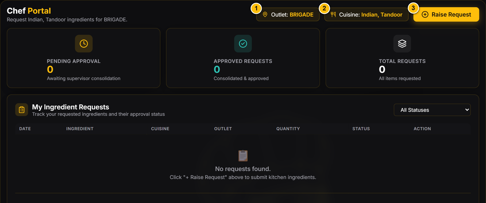
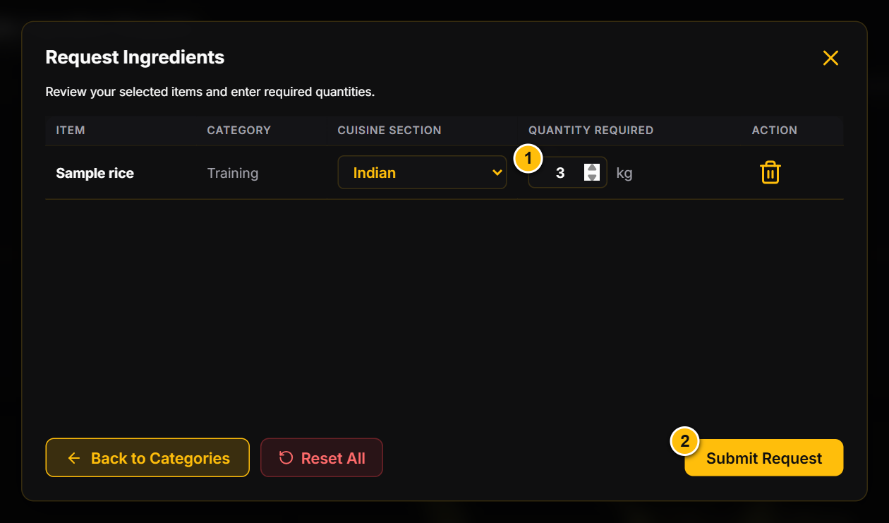
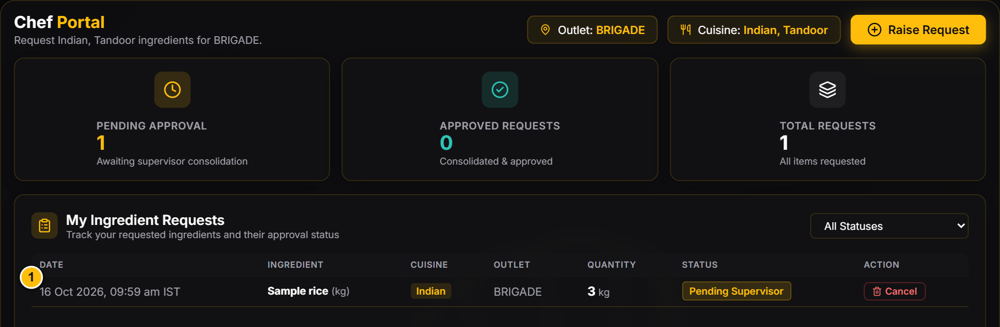

# N-CHEF | Chef guide

Revision: 16 October 2026 | English | Desktop edition

Request ingredients for your kitchen and track your own requests. Screenshots use a disposable local database with fictional staff and transactions.

## 1. Your role and quick start

Your account is assigned to an outlet and one or more cuisine sections. You can request active ingredients and view your own requests. You do not manage stock balances, receive deliveries, approve requests or create other users.

- Sign in and check your outlet and cuisine assignment.
- Select needed ingredients across categories.
- Review quantities, units and cuisine before submitting.
- Check My Requests for progress; ask your supervisor about changes or rejection.

Expected result: you can raise kitchen requirements without needing an inventory balance. Request submission alone does not guarantee approval or delivery.

## 2. Sign in and check your assignment

1. Open the N-CHEF address provided by your organization.
2. Enter the Username and Password provided by your Supervisor or Admin. Click Login.
3. Open My Requests and check the outlet and cuisine badges at the top.
4. If the assignment is wrong, ask your Supervisor to correct cuisine access or Admin to correct the outlet.
5. Use the Logout icon beside your account when finished. Sign in again if your session expires after eight hours.

Expected result: the Chef Portal shows your own request workspace. The request outlet is fixed to your assigned outlet; you cannot switch it to another branch.

Sample data. Callouts: 1 Assigned outlet; 2 Cuisine access; 3 Raise Request. No live stock balances appear in this workspace.

## 3. Choose ingredients across categories

1. Click Raise Request on the Chef Portal.
2. Check the displayed Outlet and choose the relevant assigned Cuisine.
3. Choose a category tab and click the needed ingredient cards. Selected cards are highlighted.
4. Use another category tab or Next Category to continue. You can skip unwanted categories; selected ingredients remain selected across categories.
5. Click Review & Submit whenever you are ready; you do not need to visit every category.

Expected result: selected ingredients appear on the quantity review screen. If you have multiple cuisines, check the cuisine on each line at review. Selecting an item under another cuisine can update that item's selection rather than creating a second copy of it.

Sample data. Callouts: 1 Cuisine selector; 2 Category tabs; 3 Review & Submit. Click ingredient cards to select them.

## 4. Review quantities and submit

1. Review the selected ingredient names and displayed units.
2. Enter a positive quantity for each ingredient you want to request. For example, enter 3 for 3 kg when the unit is kg.
3. Check the cuisine selection on every line; choose only a cuisine assigned to you.
4. Use Back to Categories to revise selections. Reset All clears the selection so you can start again.
5. Click Submit Request and wait for the Requests Submitted confirmation.

Expected result: positive-quantity lines are saved and appear in My Ingredient Requests as Pending Supervisor. Lines left at zero are not submitted. If no line has a positive quantity, the app asks you to enter one.

> Check before repeating: if a save reports an error or the connection drops, refresh My Requests first. Submit again only after confirming that the intended request was not saved.

Sample data. Callouts: 1 Requested quantity; 2 Submit Request. Review the ingredient's unit and cuisine on the same row.

## 5. Track your requests

1. Return to My Requests and review My Ingredient Requests.
2. Use the status filter to narrow the list, or choose All Statuses to review every request.
3. Review quantity, cuisine, submission details and status. Your Supervisor may revise quantities during consolidation.
4. For a Pending or Accepted request that is no longer needed, use its Cancel action and confirm. Once consolidated, ask your Supervisor about changes. Do not create a duplicate request just to chase an update.

- **Pending Supervisor:** submitted and awaiting supervisor review.
- **Accepted:** reviewed by the supervisor; not yet an approved stock issue.
- **Sent to Admin / Consolidated:** included in the approval process.
- **Approved:** Admin approved and the app recorded the outlet stock issue.
- **Rejected:** declined; discuss the reason and next action with your Supervisor.
- **PO Raised:** a purchase order was recorded; this does not mean goods have arrived. The current Chef table can incorrectly label this outcome Rejected. Ask your Supervisor to check Purchase Orders before treating it as a rejection.

> Current display limitations: the Approved summary card also counts Consolidated requests. Read the individual row status to distinguish consolidation from approval. A row displays the originally requested quantity; ask your Supervisor for any revised or approved quantity.

Sample data. Callout: 1 Your submitted ingredient request and its status. Use the status filter to find pending work.

## 6. Common problems

- **Cannot sign in:** check the username and password with your Supervisor or Admin. Ask them to reset the password if necessary.
- **Wrong outlet or missing cuisine:** ask your Supervisor or Admin to correct the assignment; sign out and in after it changes.
- **Ingredient not visible:** try the appropriate category and ask your Supervisor to check the catalog with Admin. Inactive ingredients cannot be selected.
- **Review button asks for a selection:** select at least one ingredient card first.
- **Submit asks for a quantity:** enter a positive number for at least one selected ingredient and check its unit.
- **Request not immediately updated on another device:** updates normally arrive through polling every ten seconds. Refresh if needed.
- **Request rejected or changed:** ask your Supervisor about the kitchen plan before raising another request.
- **No approval or delivery message:** check My Requests and speak to your Supervisor. Automatic WhatsApp or recipient-based notifications are not implemented.

Keep your password private and sign out on shared devices. Available inventory is not part of the Chef workflow; ask your Supervisor about stock and delivery timing.
