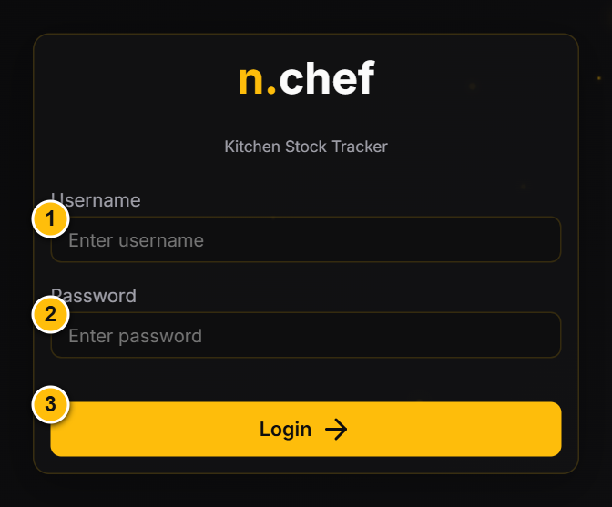
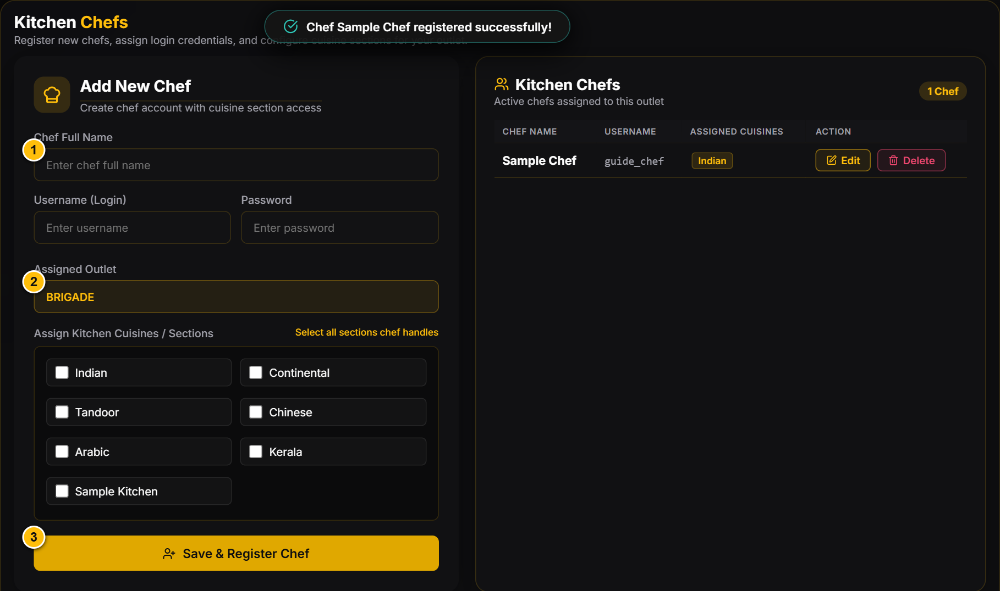
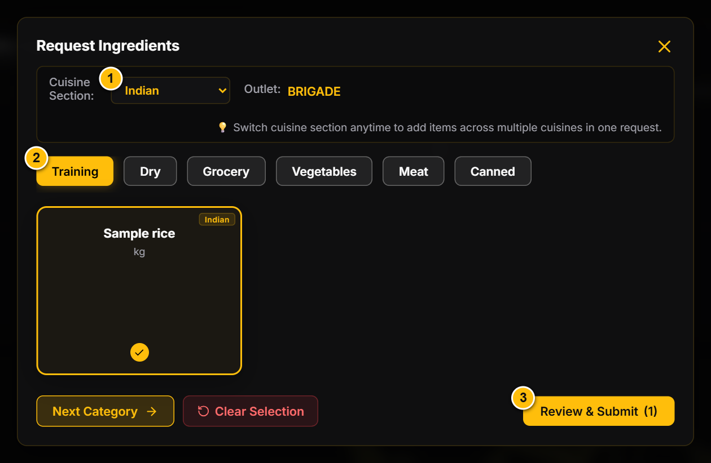
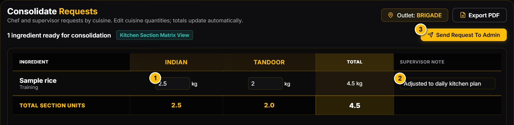
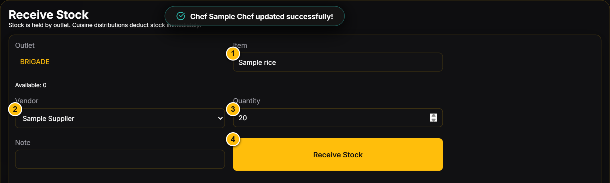
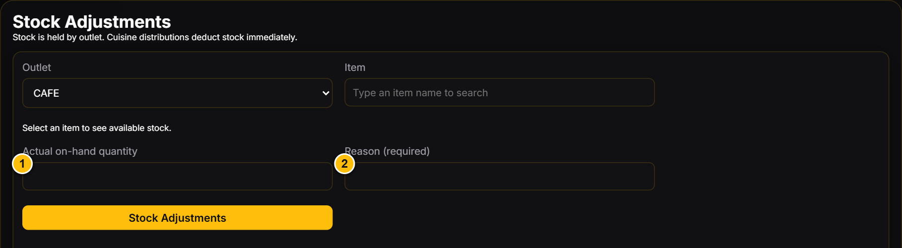
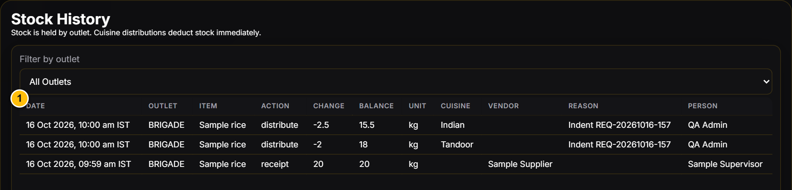

# N-CHEF | Supervisor guide

Revision: 16 October 2026 | English | Desktop edition

Manage your outlet's chefs, requirements and stock. Screenshots use a disposable local database with fictional staff and transactions.

## 1. Your role and daily checklist

Supervisors work only within their assigned outlets. You can create and edit permitted chef accounts, raise your own requirements, consolidate requests, receive deliveries through Receive Stock, issue stock and correct verified counts. Admins approve requests and maintain catalog items, vendors, locations and cuisine sections.

- Check your outlet before every movement.
- Review chef requests and add your own requirements when needed.
- Revise cuisine quantities, explain changes and send the consolidated request to Admin.
- Record actual incoming deliveries once.
- Check Master Orders and Stock History at the end of the day.

> Approval already issues stock: when an Admin approves a request, the app deducts stock and records its cuisine distribution. Do not issue the same approved quantities again through Distribute to Cuisine.

## 2. Sign in and check your outlet

1. Open your organization's N-CHEF address.
2. Enter the Username and Password provided by an Admin, then click Login.
3. Confirm your account name and outlet. A single assigned outlet is locked in stock forms. If you have multiple permitted outlets, select the correct one wherever a selector appears.
4. Use the Logout icon beside your account when finished.

Expected result: you see only permitted outlet workflows. Sessions expire after eight hours. Contact an Admin for a password reset or incorrect outlet assignment.

Sample data. Callouts: 1 Username; 2 Password; 3 Login. No password is shown.

## 3. Add a chef or change cuisine access

1. Click Add Chef in the sidebar.
2. Enter Chef Full Name, Username (Login) and an initial password of at least 12 characters. Use a unique username containing 3-64 letters, digits, dots, underscores or hyphens.
3. Check the displayed outlet and select at least one cuisine section.
4. Click Save & Register Chef. Confirm the chef appears under Kitchen Chefs.
5. To update a chef, click Edit in their row, change their details or cuisine checkboxes, and save. Leave the password blank to keep it; enter a new password to reset it.

Expected result: the chef can sign in and raise requirements for the assigned outlet and cuisines. You cannot create Admins or Supervisors, assign chefs outside your outlet access, or add cuisine sections. Ask an Admin to transfer a chef to a different outlet or create a missing cuisine.

Sample data. Callouts: 1 Full name; 2 Assigned outlet; 3 Save & Register Chef. Cuisine checkboxes are between the outlet and save controls.

## 4. Raise your own ingredient requirements

1. Open Requests > Raise Request.
2. Check Outlet and select the cuisine for the requirement.
3. Choose a category and click each needed ingredient card. Use category tabs or Next Category to move through the catalog; you can skip categories.
4. Click Review & Submit when ready. Enter positive quantities in each ingredient's displayed unit and check the cuisine for each line.
5. Use Back to Categories to change selections if needed. Click Submit Request.

Expected result: your requirements are saved and appear alongside chef requests in Consolidate Request. Submitting a requirement does not receive or distribute stock. If no ingredients appear in a category, ask Admin to check active catalog items.

Sample data from the shared request wizard, shown here in a Chef account. Callouts: 1 Cuisine; 2 Category tabs; 3 Review & Submit. Supervisors use the same selection and review steps within their permitted outlet access.

## 5. Consolidate and submit to Admin

1. Open Requests > Consolidate Request. Review the ingredients raised by chefs and by you.
2. Read the quantities in each cuisine column. Edit a cuisine quantity when the requirement changes; ingredient totals update automatically.
3. Enter a Supervisor Note explaining any revision. Keep quantities non-negative and check the unit for every ingredient.
4. Review all cuisine quantities and ingredient totals. Do not interpret the grand total across different units as a single weight or stock quantity.
5. Click Send Request To Admin and review the confirmation summary. Confirm Send Request To Admin.

Expected result: the app creates a Pending Approval consolidated request and marks its linked requirements Consolidated. The revised cuisine quantities and notes are sent together. Consolidation does not move stock; Admin approval does.

Sample data. Callouts: 1 Editable cuisine quantity; 2 Supervisor Note; 3 Send Request To Admin. Ingredient totals are calculated.

## 6. Receive deliveries and purchase orders

### Delivery without a recorded purchase-order receipt

1. Open Stock > Receive Stock and check the Outlet.
2. Type the item name and choose its matching search result. Check the unit.
3. Select the delivering Vendor, enter the positive Quantity and optionally a Note.
4. Click Receive Stock and verify the receipt in Stock History. Record separate entries for separate vendor deliveries.

### Recorded purchase order

1. Ask Admin to identify the existing recorded order. The sidebar Purchase Orders link currently opens Consolidated Requests; the actual order list is under the Admin Vendors screen, which has no normal Supervisor navigation.
2. Verify that the goods have arrived and match the remaining ordered quantities. Ask Admin to use Receive on the existing order.
3. Confirm that the receipt appears in your outlet's Stock History. Do not also enter it through Receive Stock. Admin's current Receive action books every remaining ordered line; it does not offer partial receipt quantities.

Expected result: the receipt increases your outlet's stock. A purchase-order receipt marks only that vendor's order Received. Receiving stock does not itself distribute it to cuisines. Admin can create separate vendor orders through Raise to Vendor and download one supplier-only PDF for each vendor.

Sample data. Callouts: 1 Item search; 2 Vendor; 3 Quantity; 4 Receive Stock.

## 7. Issue stock and correct a count

### Separate issue to a cuisine

1. Open Stock > Distribute to Cuisine and check Outlet and Item.
2. Choose Cuisine and enter the positive Quantity being issued, with an optional Note.
3. Click Distribute to Cuisine and check Stock History.

Expected result: stock is deducted immediately. Only use this for an issue not already recorded by Admin approval. Insufficient stock blocks the issue; the current app does not allow negative stock or automatically escalate a shortage.

### Physical-count adjustment

1. Open Stock > Stock Adjustments. Select Outlet and Item.
2. Enter the verified Actual on-hand quantity, not the difference from the old balance.
3. Enter a Reason and click Stock Adjustments.

Expected result: the count becomes the new balance. If the system shows 10 kg and the count is 8 kg, enter 8. Ask an Admin to handle any legacy reconciliation warning.

Sample data, shown in an Admin account using the same stock form. Callouts: 1 Actual on-hand quantity; 2 Required reason. Supervisors use it only for their permitted outlets.

## 8. Track requests, orders and stock

1. Open Requests > Manage Requests to review request status and linked consolidated requests. Pending means awaiting supervisor review; Consolidated or Sent to Admin means awaiting Admin action.
2. Review outcomes: Approved means the stock issue was recorded; Rejected means declined; PO Raised means a purchase order was recorded and is not proof of delivery.
3. Ask Admin to check Vendors > Purchase Orders Raised to Vendors for supplier, expected delivery and whether an existing order is Received. The sidebar Purchase Orders screen currently lists consolidated requests instead.
4. Open Master Orders. Set Category, searchable Item, From (IST) and To (IST). Read opening balance, receipts, cuisine Usage, adjustments and remaining stock for your outlet.
5. Open Stock > Stock History to trace the action, quantity change, resulting balance, person, cuisine, vendor and reason. Timestamps display in IST.

Expected result: you can explain stock changes from their history. Usage means issued quantities, not separately measured consumption. Stock Overview is Admin-only; use Master Orders for your outlet report.

Sample data, shown in an Admin account. Callout: 1 Stock movement history. Supervisors see history only for their permitted outlets.

## 9. Common problems

- **No pending requests in consolidation:** check the outlet and whether requirements were submitted successfully or already consolidated.
- **Missing cuisine or ingredient:** ask an Admin to add the cuisine or check the item category and Active status.
- **Chef creation fails:** check username uniqueness, a password of at least 12 characters, cuisine selection and permitted outlet.
- **Insufficient stock:** verify the outlet, unit and previous approvals. Record genuine arrivals; ask Admin about outstanding purchase orders. Do not issue the same approved request twice.
- **Data changed / change was not saved:** refresh and review the latest records before retrying. Confirm whether the first operation succeeded.
- **Need a different outlet:** ask an Admin to update assignments. You cannot grant yourself access.
- **Delivery differs from the order:** resolve the mismatch with Admin before using Receive, which books the remaining order in full.
- **Other device has not updated:** confirmed changes normally refresh through polling every ten seconds; refresh and check for a save error if needed.

On-screen confirmations are available. Automatic messages to managers and WhatsApp notifications are not implemented.
